

<a href="https://github.com/pratuyshswain"><picture><source media="(prefers-reduced-motion: reduce)" srcset="./assets/dashboard/name.svg"/></picture></a>

<a href="https://github.com/pratuyshswain"><b>@pratuyshswain</b></a>

 

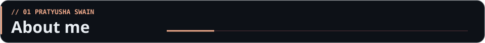

<a href="https://github.com/pratuyshswain?tab=repositories">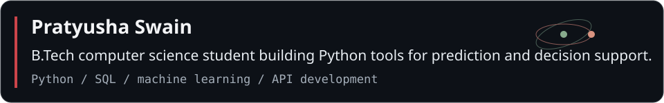</a>


<i>Which customers might leave? How much stock will a shop need next month?</i> Questions behind my retention and forecasting projects

In [cv-benchkit PR #89](https://github.com/udayraj1238/cv-benchkit/pull/89), I added input-path validation for COCO, YOLO and VOC conversions and six regression tests. The maintainers merged the change. I used AI assistance for implementation and testing.

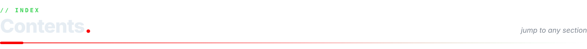

<a href="#about-me">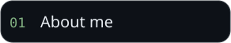</a> <a href="#tech-stack">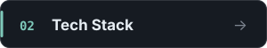</a> <a href="#current-focus">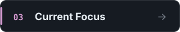</a> <a href="#yearly-highlights">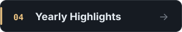</a> <a href="#github-stats">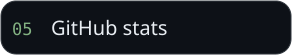</a> <a href="#recent-activity">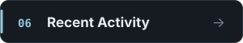</a>   <a href="#engineering-checks">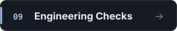</a> <a href="#contribution-graph">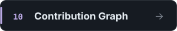</a> <a href="#connect-with-me">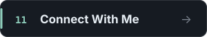</a> <a href="#guestbook">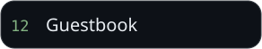</a> 

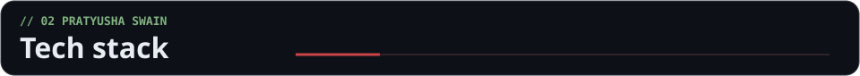

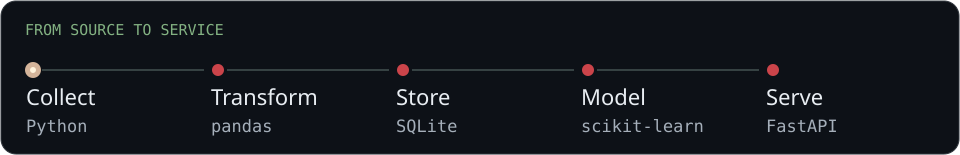

Explore my full tool inventory

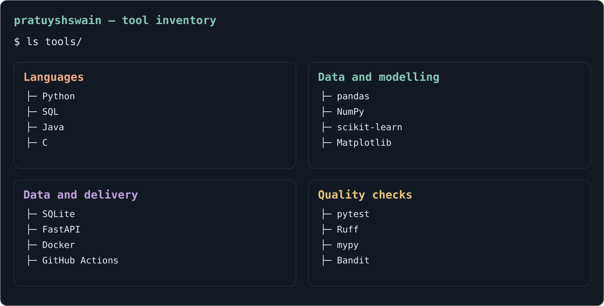

Docker for packaging, pytest for tests, and GitHub Actions for CI. The featured projects also use Ruff, mypy and dependency auditing.

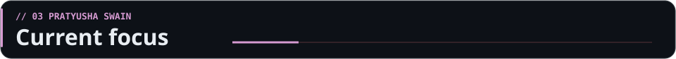

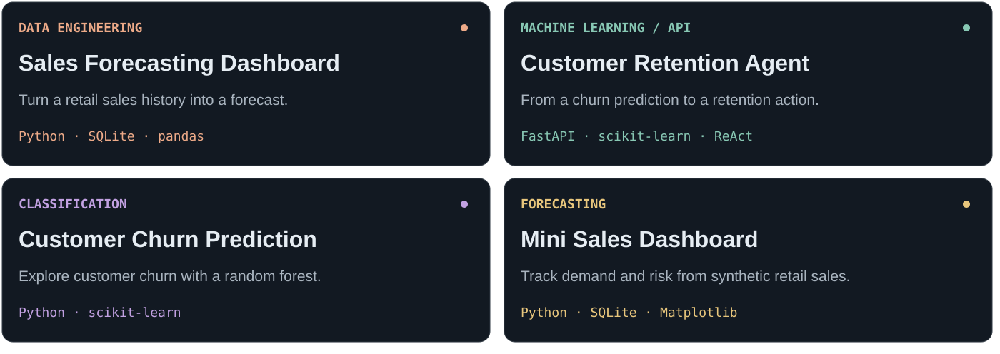

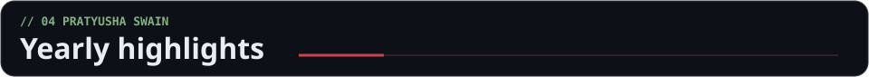

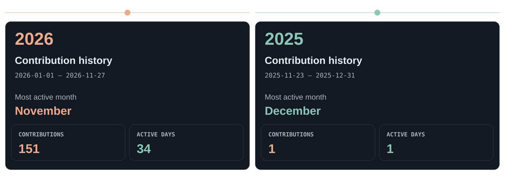

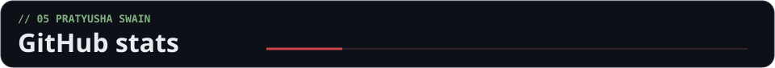

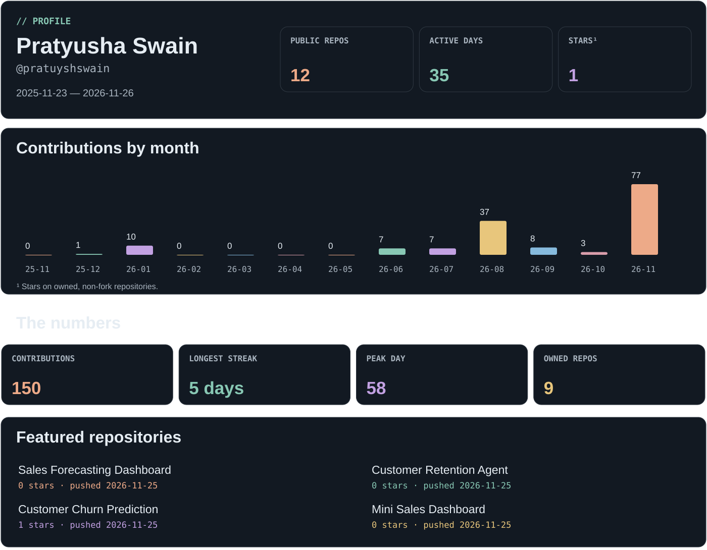

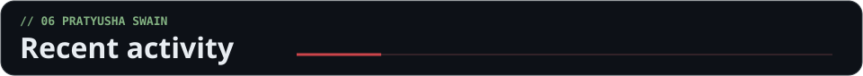

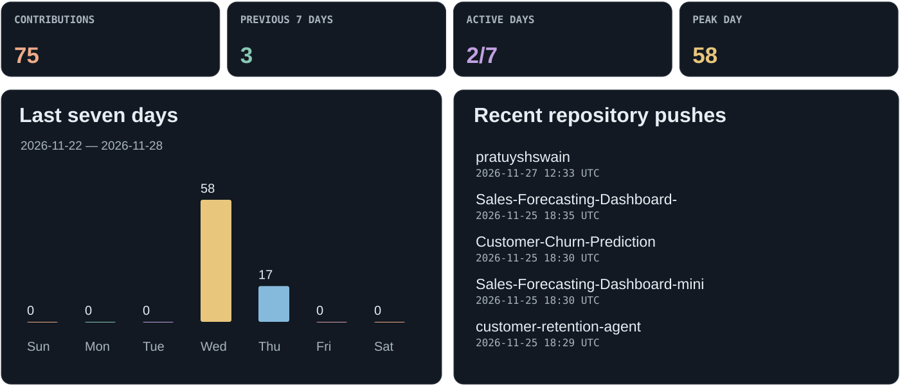

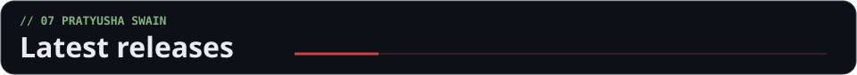

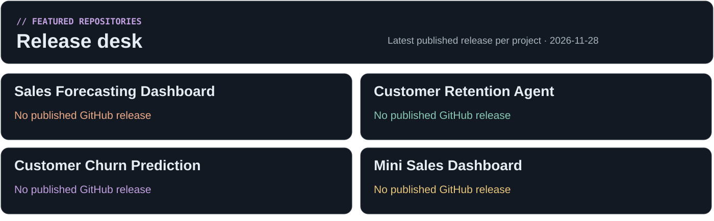

[Sales Forecasting Dashboard](https://github.com/pratuyshswain/Sales-Forecasting-Dashboard-/releases) · [Customer Retention Agent](https://github.com/pratuyshswain/customer-retention-agent/releases) · [Customer Churn Prediction](https://github.com/pratuyshswain/Customer-Churn-Prediction/releases) · [Mini Sales Dashboard](https://github.com/pratuyshswain/Sales-Forecasting-Dashboard-mini/releases)

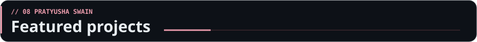

<a href="https://github.com/pratuyshswain/Sales-Forecasting-Dashboard-">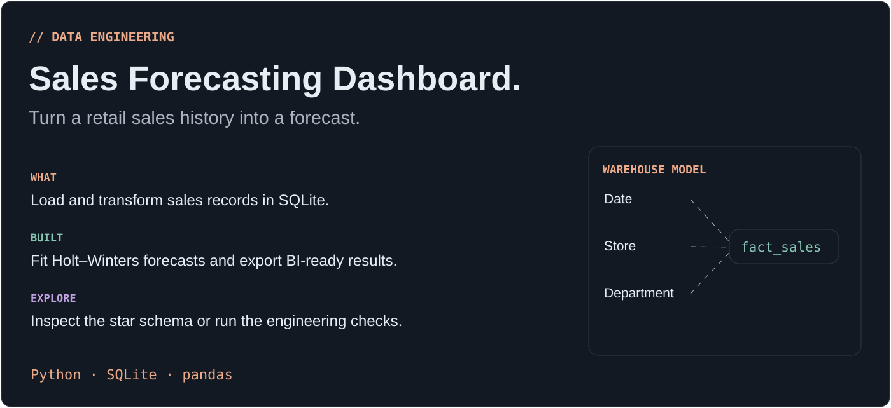</a>

<a href="https://github.com/pratuyshswain/customer-retention-agent">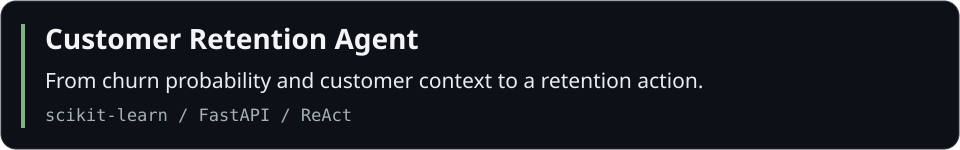</a>

<a href="https://github.com/pratuyshswain/Customer-Churn-Prediction">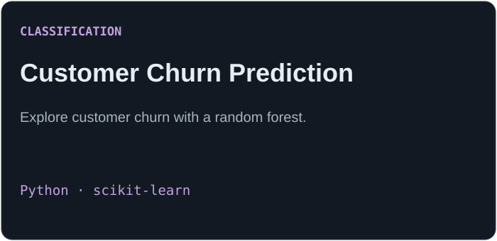</a> <a href="https://github.com/pratuyshswain/Sales-Forecasting-Dashboard-mini">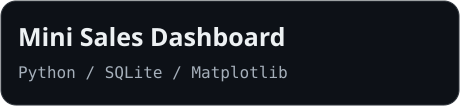</a>

[Sales warehouse schema](https://github.com/pratuyshswain/Sales-Forecasting-Dashboard-/blob/main/docs/schema_reference.md) · [Retention agent implementation](https://github.com/pratuyshswain/customer-retention-agent/blob/main/src/agent_orchestrator.py)

| Repository | Latest engineering workflow on main |
| --- | --- |
| Sales Forecasting Dashboard |  |
| Customer Retention Agent |  |
| Customer Churn Prediction |  |
| Mini Sales Dashboard |  |

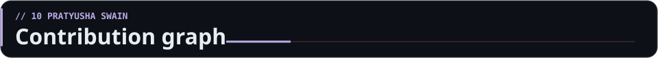

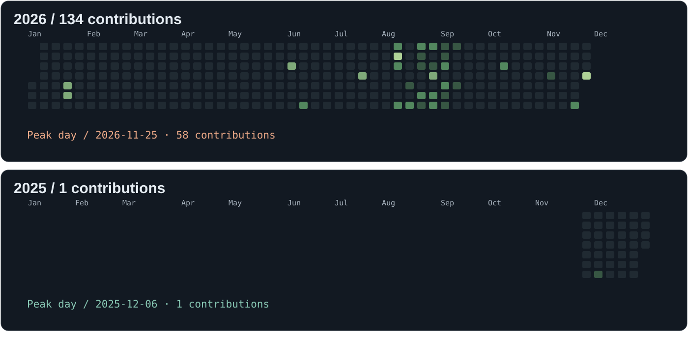

<picture><source media="(prefers-reduced-motion: reduce)" srcset="./assets/dashboard/skyline.svg"/>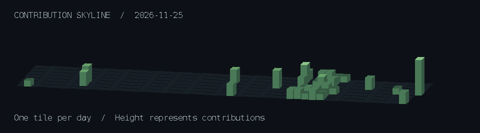</picture>

[Explore the contribution calendar on GitHub](https://github.com/pratuyshswain?tab=overview)

### Games

**[Contour Survey ↗](https://raw.githack.com/pratuyshswain/pratuyshswain/main/docs/index.html)** — Rotate a 3D landscape and identify its highest marked station. Three rounds, four stations per round. [Get the standalone HTML](https://github.com/pratuyshswain/pratuyshswain/raw/refs/heads/main/docs/index.html).

**Beat the baseline** — A shop sold **80, 100, then 120 units** over three weeks. For week four, the shopkeeper predicts 120, the last observed value. Pick your forecast to reveal the actual sales and see who was closer.

100 units · use the three-week average

Actual sales were **135**. Your forecast missed by 35 units. The shopkeeper missed by 15 and wins this round.

140 units · continue the weekly trend

Actual sales were **135**. Your forecast missed by 5 units. You beat the baseline by 10 units. The next test would be to repeat this comparison over several held-out weeks.

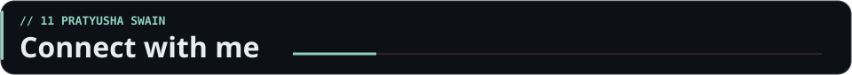

<a href="https://github.com/pratuyshswain">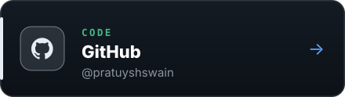</a> <a href="https://github.com/pratuyshswain?tab=repositories">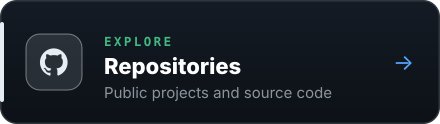</a>

[Upstream contribution to cv-benchkit](https://github.com/udayraj1238/cv-benchkit/pull/89)

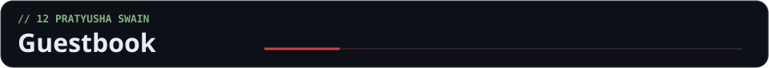

<a href="https://github.com/pratuyshswain/pratuyshswain/issues/new?template=guestbook.yml">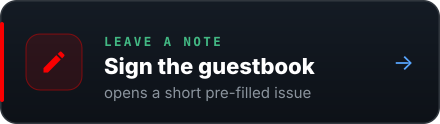</a> <a href="https://github.com/pratuyshswain/pratuyshswain/issues?q=is%3Aissue+in%3Atitle+%22Guestbook%22">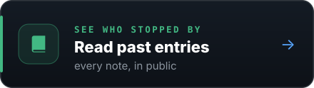</a>

[Browse profile animations](./ANIMATIONS.md)

<a href="#top">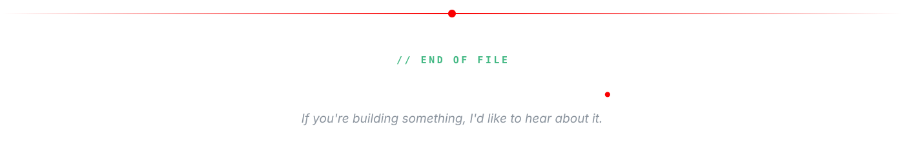</a>
