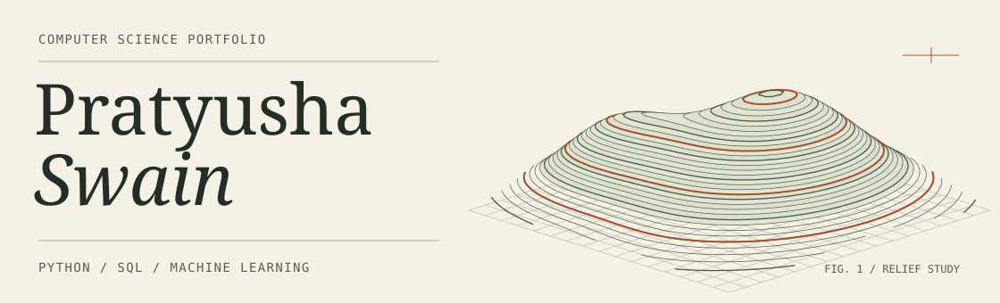
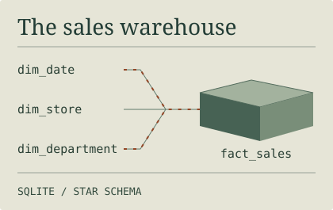
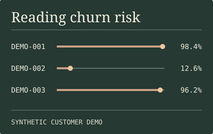

[Project spotlight](#project-spotlight) · [Games](#games) · [Open source](#open-source) · [All repositories](https://github.com/pratuyshswain?tab=repositories)

I'm Pratyusha, a B.Tech computer science student. Two questions run through my Python projects: *what will a shop sell next month, and which customers might leave?* I work on the parts that make those predictions usable, from the warehouse schema to the API that serves a score.

## Project spotlight

**[Sales Forecasting Dashboard](https://github.com/pratuyshswain/Sales-Forecasting-Dashboard-)** brings retail records into a SQLite warehouse, generates Holt–Winters forecasts and exports the results for BI tools. Start with the [warehouse schema](https://github.com/pratuyshswain/Sales-Forecasting-Dashboard-/blob/main/docs/schema_reference.md) to see how sales are grouped by store, department and date.

**[Customer Retention Agent](https://github.com/pratuyshswain/customer-retention-agent)** takes a risk score and customer context and proposes a retention action through FastAPI. Follow one prediction through the [agent implementation](https://github.com/pratuyshswain/customer-retention-agent/blob/main/src/agent_orchestrator.py).

Engineering checks for both projects

| Repository | Latest engineering workflow on main |
| --- | --- |
| Sales Forecasting Dashboard |  |
| Customer Retention Agent |  |

### More projects

- **[Customer Churn Prediction](https://github.com/pratuyshswain/Customer-Churn-Prediction)** — Explore how a random forest classifies customers and how to visualize its predictions.
- **[Mini Sales Dashboard](https://github.com/pratuyshswain/Sales-Forecasting-Dashboard-mini)** — Follow a compact example from synthetic retail records to a forecast and risk chart.

## Games

**[Contour Survey ↗](https://raw.githack.com/pratuyshswain/pratuyshswain/main/docs/index.html)** — Rotate a 3D landscape and identify its highest marked station. Three rounds, four stations per round. [Get the standalone HTML](https://github.com/pratuyshswain/pratuyshswain/raw/refs/heads/main/docs/index.html).

**Beat the baseline** — A shop sold **80, 100, then 120 units** over three weeks. For week four, the shopkeeper predicts 120, the last observed value. Pick your forecast to reveal the actual sales and see who was closer.

100 units · use the three-week average

Actual sales were **135**. Your forecast missed by 35 units. The shopkeeper missed by 15 and wins this round.

140 units · continue the weekly trend

Actual sales were **135**. Your forecast missed by 5 units. You beat the baseline by 10 units. The next test would be to repeat this comparison over several held-out weeks.

## Open source

In [cv-benchkit PR #89](https://github.com/udayraj1238/cv-benchkit/pull/89), I added input-path validation for COCO, YOLO and VOC conversions and six regression tests. The maintainers merged the change. I used AI assistance for implementation and testing.

I work primarily with Python, SQL, pandas, scikit-learn and FastAPI. Across my featured repositories, I use pytest, Docker and GitHub Actions to check that the code runs beyond my own machine.
