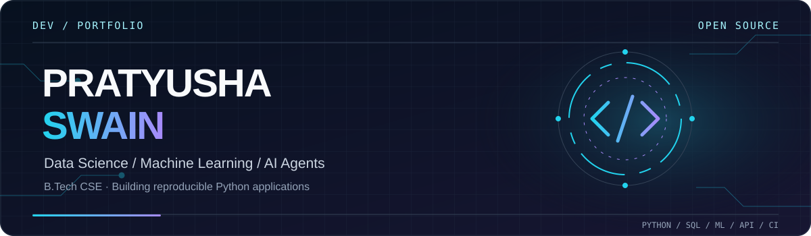
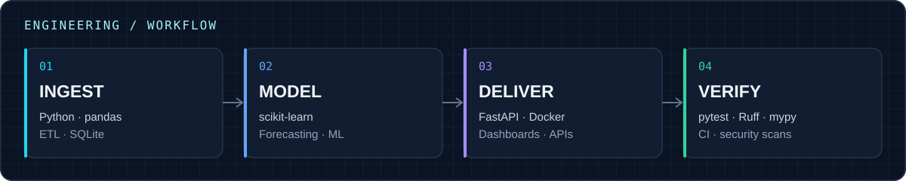

<!-- Profile dashboard: local SVG artwork; status badges reflect GitHub Actions. -->
<p align="center">
  
</p>
<p align="center">
  <a href="https://github.com/pratuyshswain?tab=repositories"></a>
  <a href="https://youtu.be/omGgEe95jlw"></a>
  <a href="https://github.com/udayraj1238/cv-benchkit/pull/89"></a>
</p>

## Interactive / Neural Lab

<p align="center"></p>

Explore a rotatable project constellation and play **Data Runner**, a keyboard- and touch-controlled arcade game. The game is a fictional data-pipeline challenge, not a performance metric.

[Interactive lab source / download](docs/index.html) · [GitHub Pages setup](docs/SETUP.md)

The animation is embedded directly in the README. The interactive lab requires a browser; GitHub Pages must be enabled before it is publicly hosted.

## 01 / Developer profile

I'm a B.Tech CSE student building practical Python applications that turn data into useful predictions, visualizations and automated workflows.

```yaml
focus: [data science, machine learning, AI agents]
engineering: [reproducibility, APIs, data pipelines, automated testing]
currently_learning: [reliable ML evaluation, agent development, CI/CD]
```

<p align="center"></p>

## 02 / Featured projects

### [Customer Retention Agent](https://github.com/pratuyshswain/customer-retention-agent)

`AI / API` · `MIT`

AI-powered retention workflows and churn predictions via FastAPI.  
**Stack:** Python · FastAPI · ML

[](https://github.com/pratuyshswain/customer-retention-agent/actions/workflows/python-checks.yml) [](https://github.com/pratuyshswain/customer-retention-agent/actions/workflows/docker-smoke.yml) [](https://github.com/pratuyshswain/customer-retention-agent/actions/workflows/engineering-checks.yml)

---

### [Sales Forecasting Dashboard](https://github.com/pratuyshswain/Sales-Forecasting-Dashboard-)

`DATA / ETL` · `MIT`

Sales ETL, SQLite warehouse, Holt-Winters forecasts and BI exports.  
**Stack:** Python · SQL · pandas

[](https://github.com/pratuyshswain/Sales-Forecasting-Dashboard-/actions/workflows/python-checks.yml) [](https://github.com/pratuyshswain/Sales-Forecasting-Dashboard-/actions/workflows/docker-smoke.yml) [](https://github.com/pratuyshswain/Sales-Forecasting-Dashboard-/actions/workflows/engineering-checks.yml)

---

### [Customer Churn Prediction](https://github.com/pratuyshswain/Customer-Churn-Prediction)

`ML / CLASSIFICATION` · `MIT`

Customer classification and model visualization with a random forest.  
**Stack:** Python · scikit-learn

[](https://github.com/pratuyshswain/Customer-Churn-Prediction/actions/workflows/python-checks.yml) [](https://github.com/pratuyshswain/Customer-Churn-Prediction/actions/workflows/docker-smoke.yml) [](https://github.com/pratuyshswain/Customer-Churn-Prediction/actions/workflows/engineering-checks.yml)

---

### [Mini Sales Dashboard](https://github.com/pratuyshswain/Sales-Forecasting-Dashboard-mini)

`DATA / FORECAST` · `MIT`

Synthetic retail data, forecasting and risk visualization in one pipeline.  
**Stack:** Python · SQLite · Matplotlib

[](https://github.com/pratuyshswain/Sales-Forecasting-Dashboard-mini/actions/workflows/python-checks.yml) [](https://github.com/pratuyshswain/Sales-Forecasting-Dashboard-mini/actions/workflows/docker-smoke.yml) [](https://github.com/pratuyshswain/Sales-Forecasting-Dashboard-mini/actions/workflows/engineering-checks.yml)

## 03 / Technology stack

**Languages**


**Data science & machine learning**


**Software engineering**


**Quality and security**


## 04 / Engineering standards

All four featured repositories use the MIT license and include contribution guidelines, security policies, Python checks, Docker smoke tests, coverage reporting, Ruff, Mypy, Bandit and dependency auditing. The workflow badges above show live status rather than hard-coded success claims.

## 05 / Upstream open-source contributions

| Project | Contribution | Outcome |
| --- | --- | --- |
| [cv-benchkit](https://github.com/udayraj1238/cv-benchkit) | [PR #89: validate convert input path types](https://github.com/udayraj1238/cv-benchkit/pull/89) | Maintainer-approved and merged; [issue #68](https://github.com/udayraj1238/cv-benchkit/issues/68) resolved |

The contribution adds source-format-specific input validation for COCO, YOLO and VOC, plus six regression tests. CI passed across Python 3.10–3.13. Implementation and tests were developed with disclosed AI assistance.

## 06 / GitHub activity

<p align="center"><a href="https://github.com/pratuyshswain?tab=overview"></a></p>

[View contribution history directly on GitHub](https://github.com/pratuyshswain?tab=overview)

## 07 / Other repositories

- [Python Network Tools](https://github.com/pratuyshswain/Python-Network-Tools) — educational networking and security exercises.
- [Python Codes](https://github.com/pratuyshswain/python-codes) — programming practice and learning examples.

## 08 / Currently learning

- Reliable ML evaluation and data pipelines
- AI agent development and API integration
- Testing, CI/CD and open-source collaboration

## 09 / Collaboration

I welcome reproducible bug reports, documentation improvements and constructive feedback. Please use the issue tracker and contribution guidelines of the relevant project.

[Browse all repositories](https://github.com/pratuyshswain?tab=repositories)

